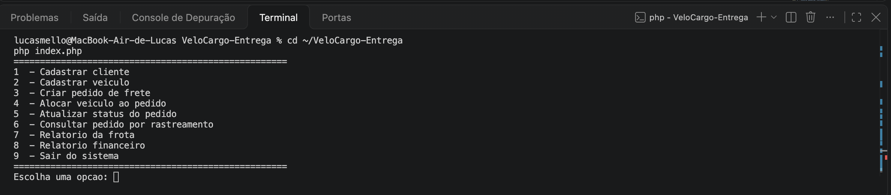

# 🚚 VeloCargo System

### Sistema de Gestão de Logística e Distribuição

Sistema de gerenciamento logístico desenvolvido em **PHP 8.5**, utilizando os princípios da **Programação Orientada a Objetos (POO)**.

O projeto simula as operações de uma empresa de logística, permitindo gerenciar clientes, veículos, pedidos de frete, seguros, rastreamento e relatórios operacionais.

---

## 📌 Sobre o projeto

O VeloCargo System é uma aplicação executada via terminal, desenvolvida como projeto acadêmico do curso de Análise e Desenvolvimento de Sistemas.

A aplicação permite controlar operações logísticas desde o cadastro de clientes e veículos até a criação, alocação e acompanhamento de pedidos de frete.

Os dados são armazenados em arquivos JSON, garantindo a persistência das informações entre diferentes execuções do sistema.


## 🖥️ Demonstração do sistema

### Menu principal



---
## ⚙️ Funcionalidades

### Gestão de clientes e frota
- Cadastro de clientes comuns e corporativos.
- Cadastro de motocicletas, utilitários urbanos (VUC) e caminhões refrigerados.
- Controle de disponibilidade dos veículos.
- Validação da capacidade e compatibilidade dos veículos com as cargas.

### Gestão de pedidos
- Criação de pedidos com múltiplos volumes.
- Classificação de cargas gerais, frágeis e refrigeradas.
- Geração automática de códigos de rastreamento.
- Cálculo automático do peso total.
- Alocação e liberação de veículos.
- Histórico cronológico de movimentações dos pedidos.

### Fretes e seguros
- Cálculo de frete conforme distância e categoria do veículo.
- Aplicação de adicionais conforme a natureza da carga.
- Desconto para clientes corporativos conforme as regras do sistema.
- Cálculo de seguro e emissão de apólices.

### Relatórios
- Relatório de disponibilidade da frota.
- Consulta detalhada de pedidos.
- Histórico de movimentações.
- Relatório financeiro com receitas, seguros e informações das cargas.

## 🛠️ Tecnologias utilizadas

- **PHP 8.5** — linguagem de programação.
- **JSON** — persistência de dados.
- **Git e GitHub** — versionamento e hospedagem do código.
- **Mermaid** — documentação do diagrama UML.
- **Visual Studio Code** — ambiente de desenvolvimento.

## 🧠 Conceitos de Programação Orientada a Objetos

O projeto aplica os principais fundamentos de POO:

| Conceito | Aplicação no projeto |
|---|---|
| Encapsulamento | Atributos privados e métodos de acesso. |
| Herança | Categorias de veículos derivadas da classe abstrata `Veiculo`. |
| Polimorfismo | Implementações específicas de custo por quilômetro e validação de cargas. |
| Abstração | Classe abstrata para comportamentos comuns dos veículos. |
| Interfaces | Interface `Seguravel` para operações relacionadas a seguros. |
| Composição | Pedidos de frete constituídos por volumes. |
| Associação | Relacionamentos entre pedidos, clientes e veículos. |

## 📂 Estrutura do projeto

```text
VeloCargo-System/
│
├── docs/
│  